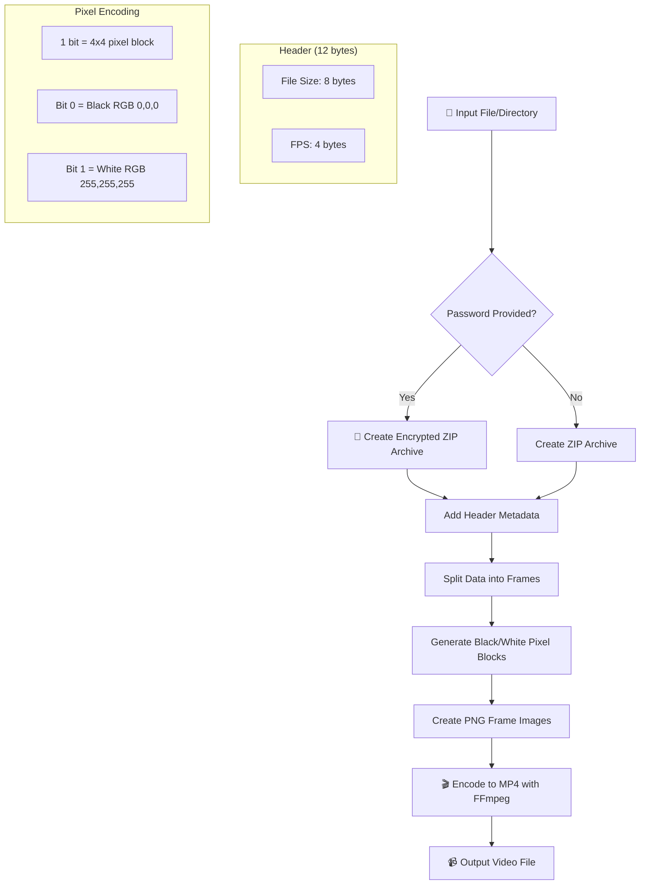
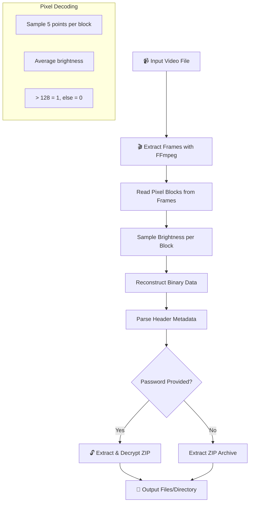
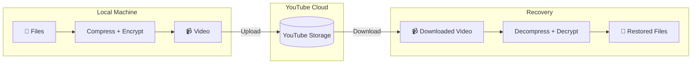

# YouTube Storage

A Rust CLI tool that encodes any file into a video that can survive YouTube's compression, allowing you to use YouTube as free cloud storage.

## How It Works

YouTube re-encodes all uploaded videos with lossy compression, which normally corrupts binary data. This tool uses a **YouTube-resilient encoding scheme**:

- **Black & White pixels only** — Maximum contrast survives compression
- **4×4 pixel blocks per bit** — Redundancy protects against artifacts  
- **Brightness threshold decoding** — Simple >128 = 1, else = 0

Each frame stores **7,200 bytes** of data at 1280×720 resolution.

## Process Flow

### Compression Process



### Decompression Process



### End-to-End Workflow



### Estimated Video Lengths

**At 30 fps (default):**

| File Size | Video Duration | Frames |
|-----------|----------------|--------|
| 1 GB | ~1.3 hours | 138,889 |
| 5 GB | ~6.5 hours | 694,444 |
| 10 GB | ~13 hours | 1,388,889 |

**At 15 fps:**

| File Size | Video Duration | Frames |
|-----------|----------------|--------|
| 1 GB | ~2.5 hours | 138,889 |
| 5 GB | ~13 hours | 694,444 |
| 10 GB | ~26 hours | 1,388,889 |

## Installation

### Prerequisites
- [Rust](https://rustup.rs/) (1.70+)
- [FFmpeg](https://ffmpeg.org/) installed and in PATH

### Build

```bash
cargo build --release
```

The binary will be at `./target/release/youtube-storage`

## Usage

### Compress (Encode file/directory → Video)

**Compress a file:**
```bash
youtube-storage compress --file mydata.zip
```

**Compress a directory:**
```bash
youtube-storage compress --file ./my-folder
```

**Compress with encryption:**
```bash
youtube-storage compress --file mydata.zip --password "your-secret-password"
```

Creates `mydata.mp4` (or `my-folder.mp4`) ready for YouTube upload.

### Decompress (Video → Original file/directory)

**Decompress without encryption:**
```bash
youtube-storage decompress --file downloaded.mp4 --output ./restored
```

**Decompress with decryption:**
```bash
youtube-storage decompress --file downloaded.mp4 --output ./restored --password "your-secret-password"
```

Works with videos downloaded from YouTube after processing. Files are extracted to the specified output directory.

## Example Workflow

1. **Encode your files with encryption:**
   ```bash
   ./target/release/youtube-storage compress --file ./my-documents --password "my-secure-pass"
   ```

2. **Upload `my-documents.mp4` to YouTube** (unlisted recommended)

3. **When needed, download the video from YouTube**

4. **Decode and decrypt back to original:**
   ```bash
   ./target/release/youtube-storage decompress --file my-documents.mp4 --output ./restored --password "my-secure-pass"
   ```

5. **Verify your files are intact in `./restored/my-documents/`**

## Technical Specifications

| Parameter | Value |
|-----------|-------|
| Resolution | 1280×720 (720p) |
| Frame Rate | 30 fps |
| Block Size | 4×4 pixels per bit |
| Bits per Frame | 57,600 |
| Bytes per Frame | 7,200 |
| Encoding | Binary (black/white) |
| Output Format | MP4 (H.264) |

### Storage Capacity

| File Size | Video Duration | Frames |
|-----------|----------------|--------|
| 1 MB | ~5 seconds | 139 |
| 10 MB | ~46 seconds | 1,389 |
| 100 MB | ~8 minutes | 13,889 |
| 1 GB | ~1.3 hours | 138,889 |

### Why It Survives YouTube

1. **Binary encoding** — Only two states (black/white), not 16 million colors
2. **Large pixel blocks** — 4×4 = 16 pixels per bit provides redundancy
3. **High contrast** — RGB(0,0,0) vs RGB(255,255,255) maximally separated
4. **Multi-point sampling** — Decoder samples 5 points per block and averages
5. **Brightness threshold** — Even if white becomes gray (200,200,200), it's still >128

## Security

### Built-in ZIP Encryption

This tool uses **standard ZIP encryption** (like `zip -e`), making encrypted archives compatible with standard ZIP tools:

- **ZipCrypto encryption** — Standard ZIP password protection
- **Integrated with compression** — Single-step zip + encrypt
- **Cross-compatible** — Archives can be extracted with `unzip`, 7-Zip, etc.

When you use the `--password` option:
1. Files are compressed into a ZIP archive
2. Each file in the archive is encrypted with your password
3. The encrypted ZIP is then encoded into the video

**⚠️ Important:** If you lose your password, the data cannot be recovered!

**💡 Tip:** For maximum security with sensitive data, consider pre-encrypting with GPG before compression.

## Limitations

- **Video length** — Large files create long videos (224 MB ≈ 36 minutes)
- **Processing time** — Encoding/decoding takes time for large files
- **YouTube limits** — Videos over 15 minutes require account verification
- **Password recovery** — No way to recover encrypted data without the password

## Tips

- **Always use encryption** — Use `--password` for any sensitive data
- **Use unlisted** — Keep videos unlisted to avoid attention
- **Download highest quality** — Always download the highest resolution available
- **Save your password securely** — Use a password manager

## License

MIT

## Disclaimer
> [!WARNING]  
> This tool is for educational purposes. Review YouTube's Terms of Service before using for storage. The authors are not responsible for any account actions or data loss.
